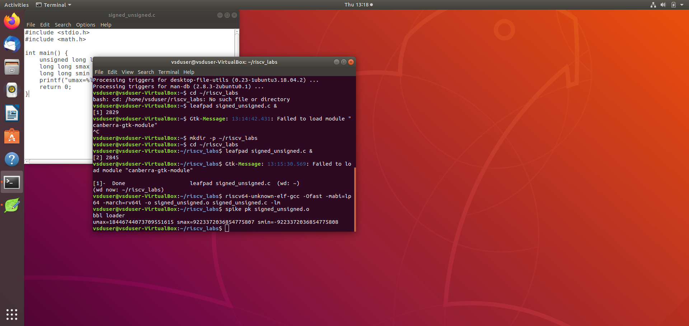

# RV_D1SK3_L3 – Lab for Signed and Unsigned Numbers

**Day 1 · Introduction to RISC-V ISA and GNU Compiler Toolchain**  
**Sub-kit D1SK3: Integer Number Representation**

## Overview

Prints the max/min values of 64-bit signed and unsigned types on the RISC-V target.

## Key Points

- Use `%llu` for unsigned long long and `%lld` for signed long long.
- Shifting `1` by 63/64 must be done on a 64-bit constant (`1ULL`) to avoid overflow surprises.
- Observe the wrap-around when a value exceeds the representable range.

## Code / Commands

```c
#include <stdio.h>
#include <math.h>

int main() {
    unsigned long long umax = (unsigned long long)(pow(2,64) - 1);
    long long smax = (long long)(pow(2,63) - 1);
    long long smin = (long long)(-pow(2,63));
    printf("umax=%llu smax=%lld smin=%lld\n", umax, smax, smin);
    return 0;
}
```

## Screenshots

<!-- Save your screenshot as day1/images/lec08_screenshot.png and remove the comment markers: -->
<!--  -->

## My Observations

- _Add what you observed when doing this lecture/lab._

---

[⬅ Back to index](../README.md)
