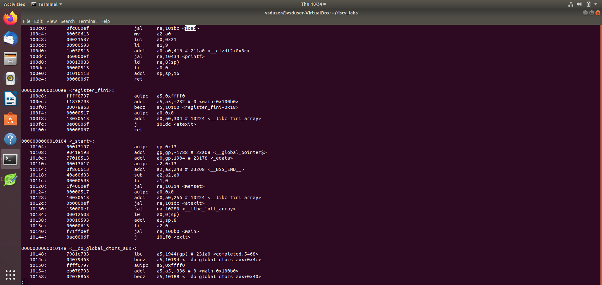
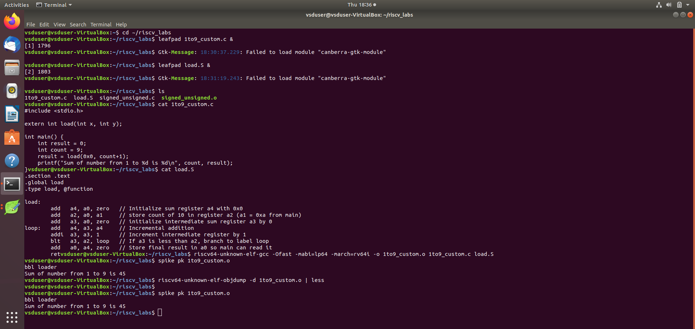

# RV_D2SK2_L3 – Simulate New C Program with Function Call

**Day 2 · Introduction to ABI and Basic Verification Flow**  
**Sub-kit D2SK2: Labwork Using ABI Function Calls**

## Overview

The sum 1..9 program is split into two parts: `main` is written in C and the summing loop is written in RISC-V assembly as a function called `load`. Both files are compiled together with the RISC-V GCC toolchain and run on Spike. The ABI decides how the two parts talk to each other: arguments go in `a0`/`a1` and the result comes back in `a0`.

## Key Points

- `extern int load(int x, int y);` tells the C compiler that `load` is defined in another file (`load.S`).
- `main` calls `load(0x0, count+1)`, so **a0 = 0** and **a1 = 10** when `load` starts.
- `.global load` makes the label visible to the linker; `ret` jumps back to the address in `ra`.
- The file extension is a capital `.S`, so the C preprocessor runs first and `//` comments are allowed.
- Both source files are passed to gcc in a single command.

## Code

### 1to9_custom.c

```c
#include <stdio.h>

extern int load(int x, int y);

int main() {
    int result = 0;
    int count = 9;
    result = load(0x0, count+1);
    printf("Sum of number from 1 to %d is %d\n", count, result);
}
```

### load.S

```asm
.section .text
.global load
.type load, @function

load:
        add   a4, a0, zero   // Initialize sum register a4 with 0x0
        add   a2, a0, a1     // store count of 10 in register a2 (a1 = 0xa from main)
        add   a3, a0, zero   // initialize intermediate sum register a3 by 0
loop:   add   a4, a3, a4     // Incremental addition
        addi  a3, a3, 1      // Increment intermediate register by 1
        blt   a3, a2, loop   // If a3 is less than a2, branch to label loop
        add   a0, a4, zero   // Store final result in a0 so main can read it
        ret
```

## Commands

```bash
cd ~/riscv_labs
leafpad 1to9_custom.c &        # write the C file, save, close
leafpad load.S &               # write the assembly file, save, close
riscv64-unknown-elf-gcc -Ofast -mabi=lp64 -march=rv64i -o 1to9_custom.o 1to9_custom.c load.S
spike pk 1to9_custom.o
riscv64-unknown-elf-objdump -d 1to9_custom.o | less    # type /load to find the function
```

## Output

Expected Spike output:

```text
bbl loader
Sum of number from 1 to 9 is 45
```

## Screenshots

### Disassembly (objdump)

`main` calls `load` with `jal ra,101bc <load>`, then moves the result into `a2` (`mv a2,a0`), loads `a1 = 9` (count) and calls `printf`:



<!-- Spike output screenshot: save as day2/images/lec15_spike.png and remove the comment markers -->
<!--  -->

## My Observations

- The C function and the assembly function link into one executable, because both follow the RISC-V ABI.
- In the disassembly, `main` reaches the assembly code with a single `jal ra,<load>`; `ra` holds the return address so `ret` comes back to `main`.
- The return value comes back in `a0`, and `main` moves it to `a2` as the third `printf` argument (`a0` = format string, `a1` = count, `a2` = result).
- The loop adds 0 + 1 + … + 9 = 45, the same answer as the pure-C version on Day 1.

---

[⬅ Back to index](../README.md)
