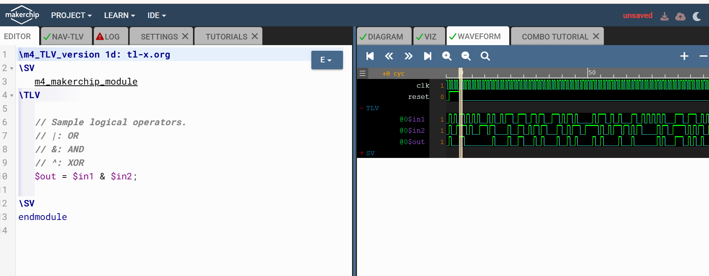
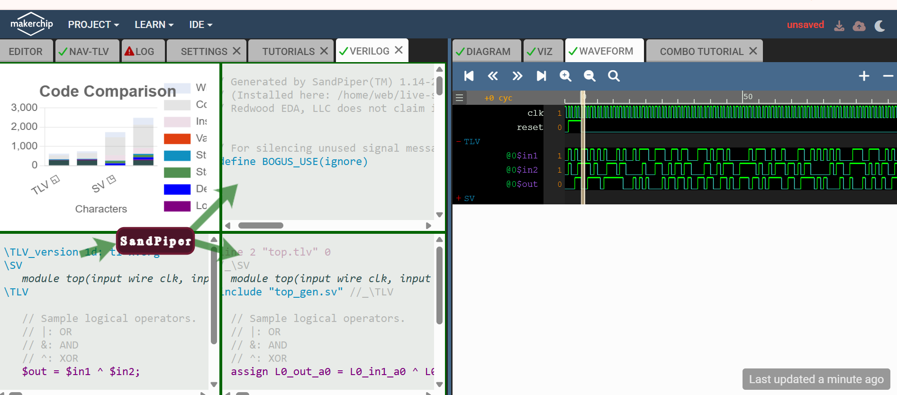
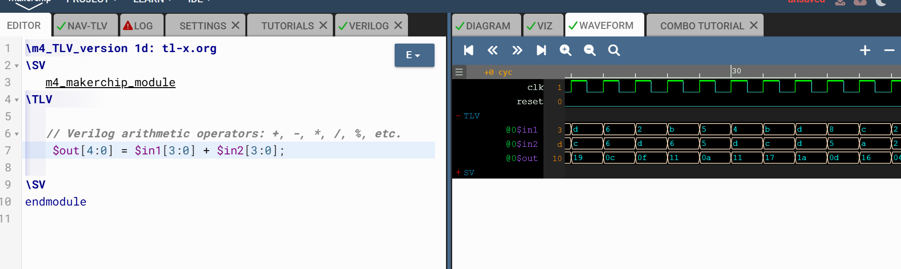
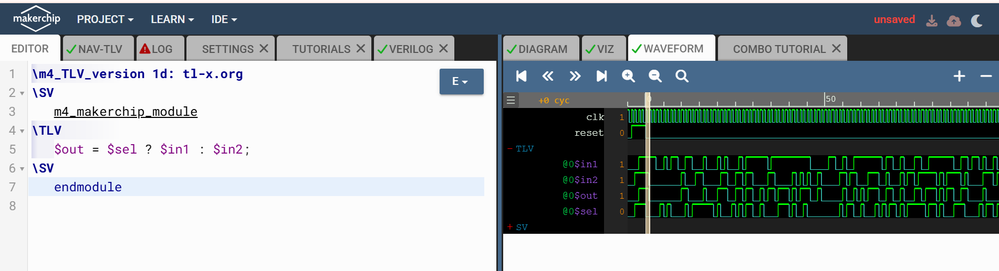
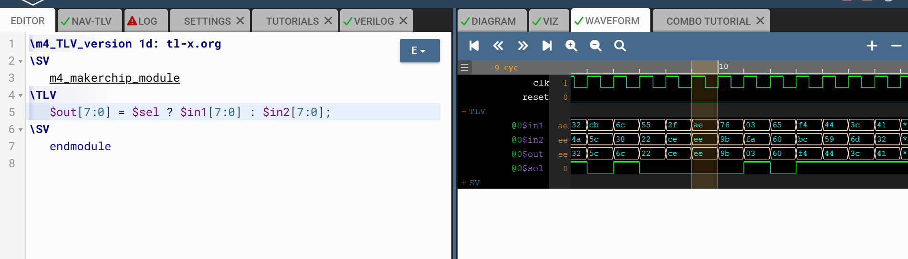
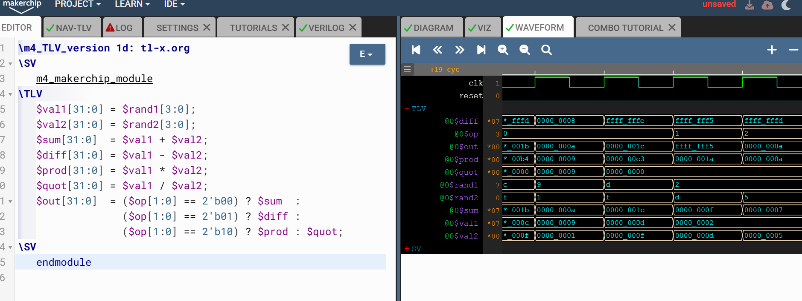

# RV_D3SK1_L3 – Labs for Combinational Logic

**Day 3 · Digital Logic with TL-Verilog and Makerchip**  
**Sub-kit D3SK1: Combinational Logic in TL-Verilog Using Makerchip**

## Overview

Combinational logic labs in TL-Verilog on Makerchip: inverter, logic gates, vectors, muxes and a combinational calculator. The output depends only on the current inputs; there is no clock-to-clock state.

## How to Run in Makerchip

1. Open [makerchip.com](https://makerchip.com) → **Launch Makerchip IDE** → new project.
2. Write the logic inside the `\TLV` section (indent with **3 spaces**, no tabs).
3. Press **Ctrl + Enter** to compile and simulate.
4. Check the **WAVEFORM**, **DIAGRAM** and **VERILOG** tabs.

Inputs that are not assigned (for example `$in1`, `$in2`) get **random values** from Makerchip automatically. The ⚠ in the LOG tab just warns about this.

## Lab 1: Logic Gates

```tlv
\m4_TLV_version 1d: tl-x.org
\SV
   m4_makerchip_module
\TLV
   // Sample logical operators.
   // |: OR
   // &: AND
   // ^: XOR
   $out = $in1 & $in2;      // AND gate
   // $out = $in1 | $in2;   // OR gate
   // $out = $in1 ^ $in2;   // XOR gate
\SV
   endmodule
```

### AND gate: code and waveform

`$out` is 1 only in the cycles where both `$in1` and `$in2` are 1.



### XOR gate: generated Verilog and waveform

`$out` is 1 when `$in1` and `$in2` are different. The VERILOG tab shows what SandPiper generates from one line of TL-Verilog: `assign L0_out_a0 = L0_in1_a0 ^ L0_in2_a0;`



## Lab 2: Vectors

```tlv
   $out[4:0] = $in1[3:0] + $in2[3:0];
```

`$out[4:0]` creates a 5-bit vector; `+` treats the vectors as binary numbers. Values in the waveform are in hex:

| in1 | in2 | out | Check (decimal) |
|---|---|---|---|
| d | c | 19 | 13 + 12 = 25 |
| 2 | d | 0f | 2 + 13 = 15 |
| b | c | 17 | 11 + 12 = 23 |
| d | d | 1a | 13 + 13 = 26 |
| c | a | 16 | 12 + 10 = 22 |



## Lab 3: Mux

The ternary operator `condition ? value_if_1 : value_if_0` creates a 2:1 multiplexer: `$sel` picks which input goes to `$out`.

### Step 1: 1-bit mux

```tlv
   $out = $sel ? $in1 : $in2;
```



### Step 2: 8-bit vector mux

```tlv
   $out[7:0] = $sel ? $in1[7:0] : $in2[7:0];
```

The bit ranges on `$in1` and `$in2` must be written explicitly, because nothing assigns these signals, so Makerchip cannot infer their width.

| sel | in1 | in2 | out | Selected |
|---|---|---|---|---|
| 1 | 32 | 4a | 32 | in1 |
| 0 | cb | 5c | 5c | in2 |
| 1 | 6c | 38 | 6c | in1 |
| 0 | ae | ee | ee | in2 |
| 1 | 03 | fa | 03 | in1 |



## Lab 4: Combinational Calculator

```tlv
   $val1[31:0] = $rand1[3:0];
   $val2[31:0] = $rand2[3:0];
   $sum[31:0]  = $val1 + $val2;
   $diff[31:0] = $val1 - $val2;
   $prod[31:0] = $val1 * $val2;
   $quot[31:0] = $val1 / $val2;
   $out[31:0]  = ($op[1:0] == 2'b00) ? $sum  :
                 ($op[1:0] == 2'b01) ? $diff :
                 ($op[1:0] == 2'b10) ? $prod : $quot;
```

`$op` selects the operation: `00` sum, `01` diff, `10` prod, `11` quot. Checking cycles from the waveform (hex):

| val1 | val2 | op | sum | diff | prod | quot | out | Selected |
|---|---|---|---|---|---|---|---|---|
| 9 | 1 | 0 | a | 8 | 9 | 9 | a | sum (9 + 1) |
| d | f | 0 | 1c | ffff_fffe | c3 | 0 | 1c | sum (13 + 15 = 28) |
| 2 | d | 1 | f | ffff_fff5 | 1a | 0 | ffff_fff5 | diff (2 − 13 = −11) |
| 2 | 5 | 2 | 7 | ffff_fffd | a | 0 | a | prod (2 × 5 = 10) |



## My Observations

- In TL-Verilog, signals start with `$` and need no declaration; Makerchip randomizes undriven inputs, so no testbench is needed.
- AND: the output is high only when both inputs are high. XOR: the output is high when the inputs differ.
- Vectors: two 4-bit inputs (max 15 each) can add up to 30, which needs **5 bits**, so `$out` is declared `[4:0]` to avoid overflow. Every sum in the waveform is correct.
- Mux: when `sel = 1` the output follows `in1`, when `sel = 0` it follows `in2`, for both the 1-bit and the 8-bit version.
- TL-Verilog needs exactly 3-space indentation; an extra-indented line stops compilation (all tabs show a red ✗).
- Calculator: `out` always matches the operation chosen by `op`. Negative differences appear in two's complement (e.g. 2 − 13 = `ffff_fff5`), and integer division drops the fraction (2 / 13 = 0).
- SandPiper turns one TL-Verilog line into a Verilog `assign` statement; the Code Comparison chart shows the TLV source is much shorter than the generated SV.

---

[⬅ Back to index](../README.md)
