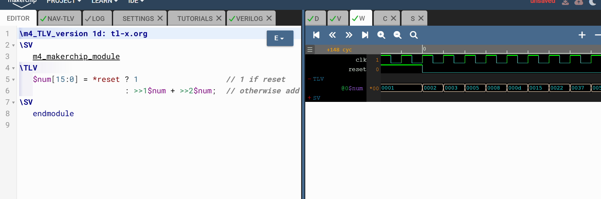
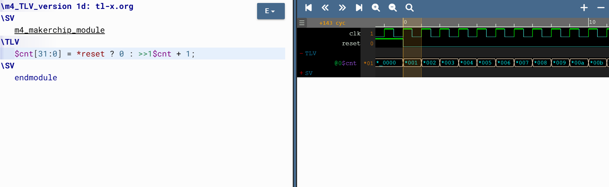

# RV_D3SK2_L1 – Introduction to Sequential Logic and Counter Lab

**Day 3 · Digital Logic with TL-Verilog and Makerchip**  
**Sub-kit D3SK2: Sequential Logic**

## Overview

Sequential logic uses flip-flops to hold state from one clock cycle to the next, so the output depends on past values as well as the current inputs. In TL-Verilog, `>>1$sig` means "the value of `$sig` one cycle ago" and `>>2$sig` means two cycles ago; SandPiper creates the flip-flops automatically.

## Key Points

- `*reset` is the reset signal provided by the `m4_makerchip_module` macro; it forces a known starting value.
- `>>1$num` and `>>2$num` are the previous two values of `$num` (one and two flip-flop stages).
- No `always @(posedge clk)` block is needed; the `>>n` notation implies the registers.

## Example: Fibonacci Sequence

Each number is the sum of the previous two, starting from 1, 1.

```tlv
\m4_TLV_version 1d: tl-x.org
\SV
   m4_makerchip_module
\TLV
   $num[15:0] = *reset ? 1                      // 1 if reset
                       : >>1$num + >>2$num;     // otherwise add previous 2 values
\SV
   endmodule
```

Reading the waveform (hex → decimal) after reset goes low:

| hex | 0001 | 0001 | 0002 | 0003 | 0005 | 0008 | 000d | 0015 | 0022 | 0037 |
|---|---|---|---|---|---|---|---|---|---|---|
| decimal | 1 | 1 | 2 | 3 | 5 | 8 | 13 | 21 | 34 | 55 |



## Lab: Counter

```tlv
   $cnt[31:0] = *reset ? 0 : >>1$cnt + 1;
```

The counter is 0 while reset is high, then increments by 1 every clock cycle: 0, 1, 2, … 9, a, b … (hex).



## My Observations

- While reset is high, `$num` stays at 1; once reset goes low, every new value is the sum of the last two: 1, 1, 2, 3, 5, 8, 13, 21, 34, 55 …
- The whole sequential circuit is a single TL-Verilog expression: `>>1` and `>>2` replace explicit flip-flop code.
- Counter: `>>1$cnt + 1` adds one to last cycle's value, so `$cnt` counts the clock cycles since reset (0000 → 001 → 002 … → 00b in the waveform).
- `$num` is 16 bits, so it can hold values up to 65535; after about 24 terms the sum overflows and wraps around.

---

[⬅ Back to index](../README.md)
