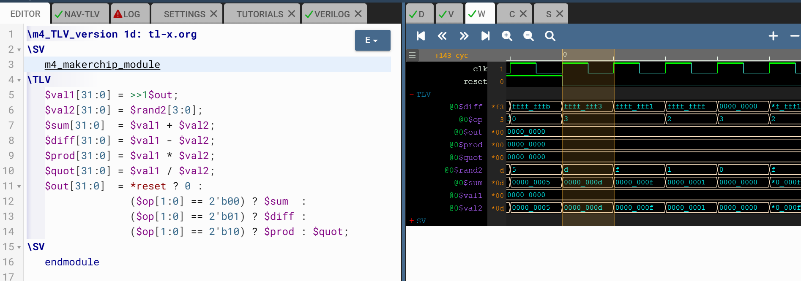

# RV_D3SK2_L2 – Sequential Calculator Lab

**Day 3 · Digital Logic with TL-Verilog and Makerchip**  
**Sub-kit D3SK2: Sequential Logic**

## Overview

The combinational calculator from D3SK1 L3 is turned into a sequential one: the result of each calculation is fed back as the first operand of the next, like a real calculator. `$val1 = >>1$out` takes last cycle's output, and `*reset` clears the result to 0.

## Code

```tlv
\m4_TLV_version 1d: tl-x.org
\SV
   m4_makerchip_module
\TLV
   $val1[31:0] = >>1$out;
   $val2[31:0] = $rand2[3:0];
   $sum[31:0]  = $val1 + $val2;
   $diff[31:0] = $val1 - $val2;
   $prod[31:0] = $val1 * $val2;
   $quot[31:0] = $val1 / $val2;
   $out[31:0]  = *reset ? 0 :
                 ($op[1:0] == 2'b00) ? $sum  :
                 ($op[1:0] == 2'b01) ? $diff :
                 ($op[1:0] == 2'b10) ? $prod : $quot;
\SV
   endmodule
```

Changes from the combinational calculator:

1. `$val1 = >>1$out`: the first operand is the previous result (feedback through a flip-flop).
2. `*reset ? 0`: the calculator starts from 0 after reset.

## Screenshot



In this window, right after reset, `op` is 3 (quotient) or 2 (product) in every cycle. Since `val1` = previous `out` = 0, and 0 ÷ x = 0 and 0 × x = 0, `out` stays `0000_0000`. Meanwhile `sum` and `diff` are computed (e.g. 0 + d = d, 0 − d = `ffff_fff3`) but are not selected. `out` only leaves 0 once `op` becomes 0 (sum) or 1 (diff).

<!-- Screenshot with out changing: save as day3/images/lec22_seq_calculator_running.png and remove the comment markers -->
<!--  -->

## My Observations

- `val1` always equals the previous cycle's `out`, which shows the feedback path works: the calculator really uses its last result.
- Starting from 0, product and quotient keep the result at 0; the value only changes when a sum or difference is selected.
- To see the accumulator grow, `op` can be fixed to sum for a test (`$op[1:0] = 2'b00;`): `out` then increases by `val2` every cycle.
- Dividing by `val2 = 0` gives an undefined result in simulation; a real calculator would need a divide-by-zero check.

---

[⬅ Back to index](../README.md)
