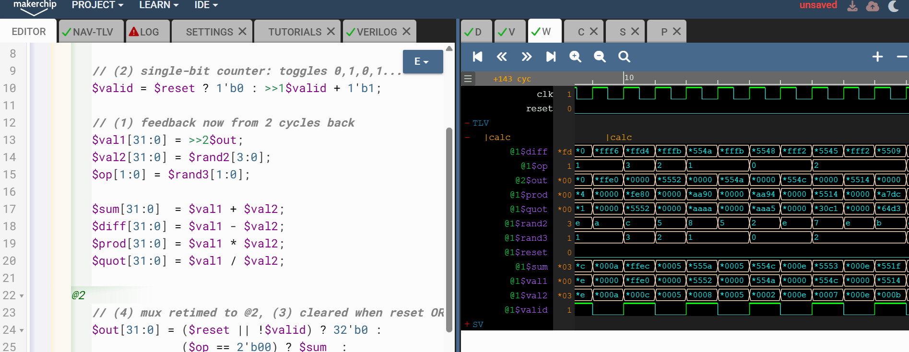

# RV_D3SK3_L4 – 2-Cycle Calculator

**Day 3 · Digital Logic with TL-Verilog and Makerchip**  
**Sub-kit D3SK3: Pipelined Logic**

## Overview

At a high clock frequency the calculator may not finish in one cycle, so it calculates every other cycle and its logic is split across two pipeline stages. Starting from the counter + calculator in stage `@1` of a `|calc` pipeline, four changes are made:

| Step | Change | Why |
|---|---|---|
| 1 | `$val1 = >>1$out` → `$val1 = >>2$out` | The result now comes back after 2 cycles |
| 2 | 32-bit `$cnt` → 1-bit `$valid` | A single bit toggles 0, 1, 0, 1 … and marks every other cycle |
| 3 | Clear `$out` when `$reset` **or** `!$valid` | Outputs on the alternate (invalid) cycles are forced to 0 |
| 4 | Move the output mux to `@2` | Less logic per stage, easier timing; **no functional change** (retiming) |

## Code

```tlv
\m4_TLV_version 1d: tl-x.org
\SV
   m4_makerchip_module
\TLV
   |calc
      @1
         $reset = *reset;
         
         // (2) single-bit counter: toggles 0,1,0,1...
         $valid = $reset ? 1'b0 : >>1$valid + 1'b1;
         
         // (1) feedback now from 2 cycles back
         $val1[31:0] = >>2$out;
         $val2[31:0] = $rand2[3:0];
         $op[1:0] = $rand3[1:0];
         
         $sum[31:0]  = $val1 + $val2;
         $diff[31:0] = $val1 - $val2;
         $prod[31:0] = $val1 * $val2;
         $quot[31:0] = $val1 / $val2;
         
      @2
         // (4) mux retimed to @2, (3) cleared when reset OR not valid
         $out[31:0] = ($reset || !$valid) ? 32'b0 :
                      ($op == 2'b00) ? $sum  :
                      ($op == 2'b01) ? $diff :
                      ($op == 2'b10) ? $prod :
                                       $quot;
\SV
   endmodule
```

Indentation: `|calc` 3 spaces, `@1`/`@2` 6 spaces, statements 9 spaces (spaces only, no tabs).

## Screenshot



Reading the waveform:

- `@1$valid` toggles 0 → 1 → 0 → 1 every cycle.
- `@2$out` alternates between a result and `0000`: results appear every other cycle, and the cycles in between are cleared by `!$valid`.
- Each result shows up as `val1` in the next column: `out` = ffe0, 5552, 554a, 554c, 5514 → `val1` = ffe0, 5552, 554a, 554c, 5514. This is the `>>2$out` feedback, so each new calculation starts from the last valid result.
- Signals are grouped under `|calc` with their stage: `@1$…` for the arithmetic, `@2$out` for the retimed mux.

## My Observations

- Splitting the logic into `@1` (arithmetic) and `@2` (mux) gives each stage less work, which allows a faster clock; the result is the same, only its timing changes.
- The 1-bit `$valid` replaces the 32-bit counter, since only "even or odd cycle" matters.
- Clearing `out` on invalid cycles makes it obvious in the waveform which outputs are real.
- Retiming the mux to `@2` only needed a new `@2` line; SandPiper inserted the flip-flops between the stages automatically.

---

[⬅ Back to index](../README.md)
