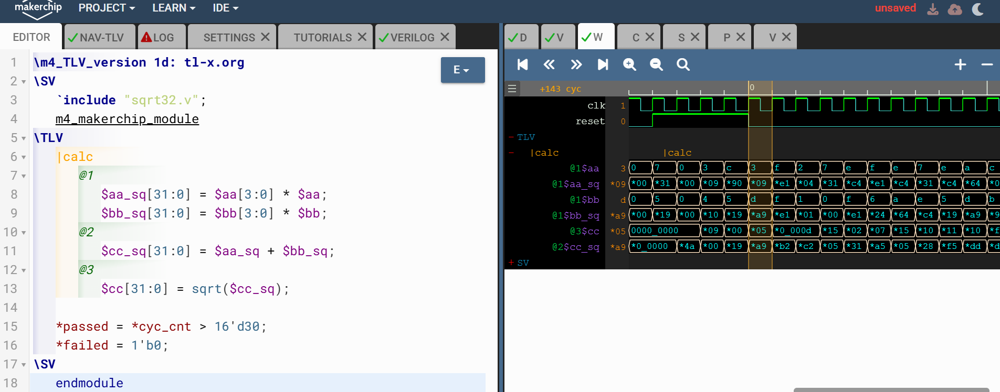
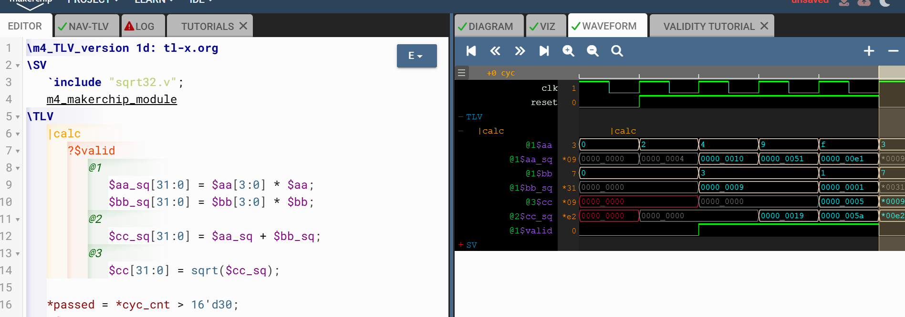

# RV_D3SK4_L2 – Lab on Validity and Valid-When Condition

**Day 3 · Digital Logic with TL-Verilog and Makerchip**  
**Sub-kit D3SK4: Validity**

## Overview

The Pythagoras pipeline (cc = √(aa² + bb²)) is built over three stages, and then a `?$valid` "when" scope is added so the computations are only meaningful in cycles where a valid transaction is present.

## Step 1: Pythagoras Pipeline

```tlv
\m4_TLV_version 1d: tl-x.org
\SV
   `include "sqrt32.v";
   m4_makerchip_module
\TLV
   |calc
      @1
         $aa_sq[31:0] = $aa[3:0] * $aa;
         $bb_sq[31:0] = $bb[3:0] * $bb;
      @2
         $cc_sq[31:0] = $aa_sq + $bb_sq;
      @3
         $cc[31:0] = sqrt($cc_sq);
   
   *passed = *cyc_cnt > 16'd30;
   *failed = 1'b0;
\SV
   endmodule
```

- `` `include "sqrt32.v" `` brings in Makerchip's square-root function.
- `$aa` and `$bb` are not assigned, so Makerchip drives them with random 4-bit values.
- Squares are in `@1`, the sum in `@2` and the square root in `@3`; SandPiper inserts the flip-flops between the stages.



Example from the waveform (one transaction, hex): `aa` = 3, `bb` = 4 → `aa_sq` = 09, `bb_sq` = 10, `cc_sq` = 19 (= 25), `cc` = 05. The waveform lines each transaction up across `@1`, `@2` and `@3`, so the values of one transaction appear in the same column.

## Step 2: Add Validity

```tlv
\TLV
   |calc
      ?$valid
         @1
            $aa_sq[31:0] = $aa[3:0] * $aa;
            $bb_sq[31:0] = $bb[3:0] * $bb;
         @2
            $cc_sq[31:0] = $aa_sq + $bb_sq;
         @3
            $cc[31:0] = sqrt($cc_sq);
```

`?$valid` means "when valid": everything inside is only meaningful in cycles where `$valid` = 1. Since `$valid` has no source, Makerchip makes it random, like transactions arriving at random times. In invalid cycles the signals are shown grey (don't care).

<!-- Validity screenshot: save as day3/images/lec28_validity.png and remove the comment markers -->
<!--  -->

## My Observations

- The pipeline computes cc = √(aa² + bb²) correctly: 3, 4 → 5.
- Splitting the work into three stages (square, add, square root) only needed `@1`, `@2`, `@3`; no flip-flop code was written by hand.
- `?$valid` adds validity without changing the computation itself: it only marks which cycles carry real transactions, which makes debugging easier and allows clock gating to save power.

---

[⬅ Back to index](../README.md)
