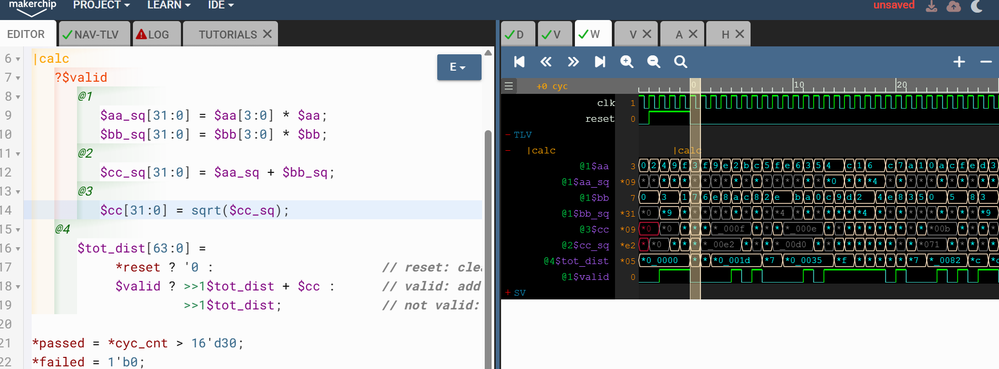

# RV_D3SK4_L3 – Lab to Compute Total Distance

**Day 3 · Digital Logic with TL-Verilog and Makerchip**  
**Sub-kit D3SK4: Validity**

## Overview

The Pythagoras pipeline from D3SK4 L2 computes a distance `cc` for every valid transaction. This lab adds stage `@4` with a running total `$tot_dist` that adds up `cc` for each valid transaction, like a trip meter.

## Key Points

- `$tot_dist` is **64 bits** wide because the total keeps growing.
- `*reset ? '0`: reset clears the total (`'0` = all bits zero, any width).
- `$valid ? >>1$tot_dist + $cc`: in a valid cycle, add this distance to the previous total.
- `: >>1$tot_dist`: in an invalid cycle, keep the previous total.
- `@4` is placed **outside** `?$valid` (same indentation as `?$valid`), because the total must hold its value in every cycle, including invalid ones.

## Code

```tlv
\m4_TLV_version 1d: tl-x.org
\SV
   `include "sqrt32.v";
   m4_makerchip_module
\TLV
   |calc
      ?$valid
         @1
            $aa_sq[31:0] = $aa[3:0] * $aa;
            $bb_sq[31:0] = $bb[3:0] * $bb;
         @2
            $cc_sq[31:0] = $aa_sq + $bb_sq;
         @3
            $cc[31:0] = sqrt($cc_sq);
      @4
         $tot_dist[63:0] =
              *reset ? '0 :                      // reset: clear to 0
              $valid ? >>1$tot_dist + $cc :      // valid: add this cc
                       >>1$tot_dist;             // not valid: keep old total
   
   *passed = *cyc_cnt > 16'd30;
   *failed = 1'b0;
\SV
   endmodule
```

Indentation: `|calc` 3, `?$valid` 6, `@1`–`@3` 9, their statements 12, `@4` 6, `$tot_dist` 9 (spaces only).

## Screenshot



Reading the waveform:

- `@1$valid` goes high only in some cycles (random), so only those transactions are real.
- `@4$tot_dist` starts at 0 after reset and grows step by step (e.g. `0000` → `001d` → … → `0035` → … → `0082`), changing only after valid transactions reach `@4`.
- Between valid transactions `tot_dist` stays constant, even though `aa`, `bb` and the other values keep changing.

## My Observations

- Validity lets the accumulator ignore garbage values in invalid cycles: only real distances are added.
- Placing `@4` outside the `?$valid` scope is essential; inside it, the total would be treated as don't-care in invalid cycles and could not hold its value.
- The total is a feedback loop through `>>1$tot_dist`, the same pattern as the counter and Fibonacci labs.
- The M4 template plus `` `include "sqrt32.v" `` is required; without the include, `sqrt()` is undefined.

---

[⬅ Back to index](../README.md)
