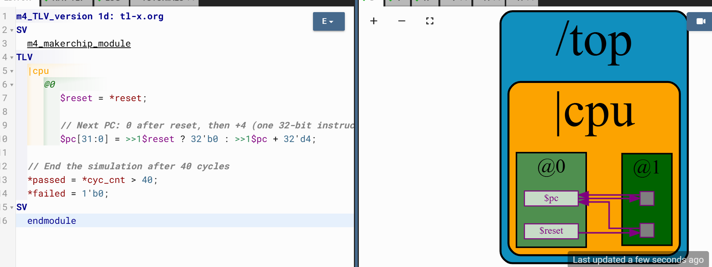
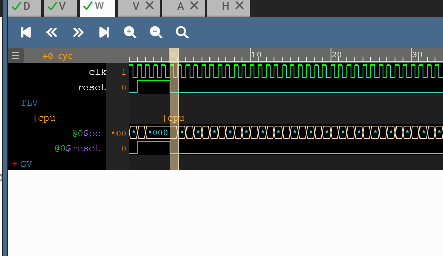

# RV_D4SK2_L1 – Implementation Plan and Lab for PC

**Day 4 · Basic RISC-V CPU Micro-architecture**  
**Sub-kit D4SK2: Fetch and Decode**

## Overview

The first step in building the RISC-V CPU is the **program counter (PC)**, which holds the address of the instruction being fetched. Each RV32I instruction is 4 bytes, so the PC steps 0, 4, 8, 12, … The PC is reset to 0 when the **previous** cycle was a reset (`>>1$reset`); branch support is added later.

## Implementation Plan

The CPU is built inside a `|cpu` pipeline, one block at a time:

| Stage | Blocks |
|---|---|
| `@0` | PC, `+1` instruction (`$inc_pc`) |
| `@1` | IMem read, decode, register file read, ALU, register file write |
| later | branches, loads/stores, jumps, full pipelining |

## Code

```tlv
\m4_TLV_version 1d: tl-x.org
\SV
   m4_makerchip_module
\TLV
   |cpu
      @0
         $reset = *reset;
         
         // Next PC: 0 after reset, then +4 (one 32-bit instruction) every cycle
         $pc[31:0] = >>1$reset ? 32'b0 : >>1$pc + 32'd4;
   
   // End the simulation after 40 cycles
   *passed = *cyc_cnt > 40;
   *failed = 1'b0;
\SV
   endmodule
```

| Part | Meaning |
|---|---|
| `$pc[31:0]` | 32-bit program counter |
| `>>1$reset ? 32'b0` | PC = 0 if reset was high in the previous cycle |
| `: >>1$pc + 32'd4` | otherwise PC = previous PC + 4 (next instruction) |

## Screenshots

### Code and diagram

The DIAGRAM shows `$pc` and `$reset` in stage `@0` of `|cpu`, with the feedback of `$pc` through a flip-flop (`>>1`) back into the PC logic.



### Waveform

After `reset` goes low, `@0$pc` changes every cycle: 0, 4, 8, c, 10, 14, … (hex).



## My Observations

- The PC is a counter that counts in steps of 4 because each instruction is 4 bytes (byte addressing).
- Using `>>1$reset` makes the PC 0 in the first cycle after reset, so the CPU starts at the first instruction.
- The diagram shows the `>>1` flip-flops that SandPiper inserted for `$pc` and `$reset`; no register code had to be written.

---

[⬅ Back to index](../README.md)
