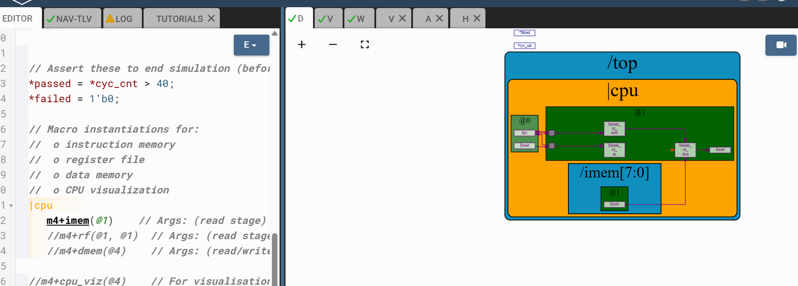
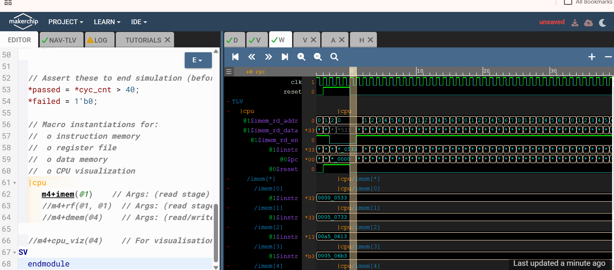

# RV_D4SK2_L2 – Lab for Instruction Fetch Logic

**Day 4 · Basic RISC-V CPU Micro-architecture**  
**Sub-kit D4SK2: Fetch and Decode**

## Overview

The PC from the previous lab is now used to read instructions from the instruction memory (IMem). The `imem` macro from the RISC-V shell is enabled in stage `@1` and connected to the PC; its output is the 32-bit instruction `$instr`.

## IMem Interface

| Signal | Direction | Meaning |
|---|---|---|
| `$imem_rd_en` | in | Read enable: read every cycle except during reset |
| `$imem_rd_addr[M4_IMEM_INDEX_CNT-1:0]` | in | Instruction index (word address) |
| `$imem_rd_data[31:0]` | out | The 32-bit instruction at that address |

`M4_IMEM_INDEX_CNT` is the number of address bits for the program (8 instructions → 3 bits). The address is `$pc[M4_IMEM_INDEX_CNT+1:2]`: the PC counts **bytes** (0, 4, 8, …) while the IMem is indexed by **instruction** (0, 1, 2, …), so the two lowest PC bits are dropped (PC ÷ 4).

## Code

Added to the RISC-V shell (`risc-v_shell.tlv` from [stevehoover/RISC-V_MYTH_Workshop](https://github.com/stevehoover/RISC-V_MYTH_Workshop)):

```tlv
   |cpu
      @0
         $reset = *reset;
         
         // ---- Lab: Next PC ----
         $pc[31:0] = >>1$reset ? 32'b0 : >>1$pc + 32'd4;
         
      @1
         // ---- Lab: Fetch ----
         $imem_rd_en = !$reset;
         $imem_rd_addr[M4_IMEM_INDEX_CNT-1:0] = $pc[M4_IMEM_INDEX_CNT+1:2];
         $instr[31:0] = $imem_rd_data[31:0];
```

and the IMem macro is enabled at the bottom of the shell (removed the `//`):

```tlv
   |cpu
      m4+imem(@1)    // Args: (read stage)
```

## Screenshots

### Diagram

`$pc` and `$reset` in `@0` feed `$imem_rd_addr` and `$imem_rd_en` in `@1`; the `/imem[7:0]` block returns `$imem_rd_data`, which becomes `$instr`.



### Waveform



Reading the waveform:

- `@1$imem_rd_en` is 0 during reset and 1 afterwards.
- `@1$imem_rd_addr` counts 0, 1, 2, … 7 and then wraps to 0 (3-bit address; branches are not implemented yet).
- The IMem contents (`/imem[n]$instr`) are the encoded sum-1-to-9 program:

| Index | Encoding | Instruction |
|---|---|---|
| 0 | `0000_0533` | `ADD r10, r0, r0` |
| 1 | `0005_0733` | `ADD r14, r10, r0` |
| 2 | `00a5_0613` | `ADDI r12, r10, 10` |
| 3 | `0005_06b3` | `ADD r13, r10, r0` |

- The first fetched instruction after reset, `@1$instr` = `0000_0533`, matches `/imem[0]`.

## My Observations

- Dropping the two lowest PC bits converts the byte address into an instruction index.
- Read enable is tied to `!$reset`, so no instruction is fetched while the CPU is in reset.
- The fetched encodings match RV32I: the lowest 7 bits `0110011` (`…33`) are the R-type opcode for ADD, and `0010011` (`…13`) is the I-type opcode for ADDI.
- Without branch logic the PC simply runs past the last instruction and the 3-bit address wraps around.

---

[⬅ Back to index](../README.md)
