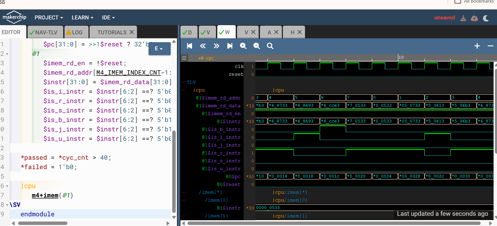

# RV_D4SK2_L3 – Lab for RISC-V Instruction Types IRSBJU Decode Logic

**Day 4 · Basic RISC-V CPU Micro-architecture**  
**Sub-kit D4SK2: Fetch and Decode**

## Overview

After fetch, each 32-bit instruction is classified as one of the six RV32I instruction formats: **I, R, S, B, J, U**. The format is decided only by the opcode bits `instr[6:2]` (the lowest two bits are always `11` for 32-bit instructions).

## Opcode Table

Row = `instr[6:5]`, column = `instr[4:2]`; together they form `instr[6:2]`.

| instr[6:5] \ instr[4:2] | 000 | 001 | 010 | 011 | 100 | 101 | 110 | 111 |
|---|---|---|---|---|---|---|---|---|
| **00** | I | I | – | – | I | U | I | – |
| **01** | S | S | – | R | R | U | R | – |
| **10** | R4 | R4 | R4 | R4 | R | – | – | – |
| **11** | B | I | – | J | I (unused) | – | – | – |

Grouping the cells (`x` = don't care) gives the patterns used in the code:

| Type | `instr[6:2]` patterns |
|---|---|
| I | `0000x`, `001x0`, `11001` |
| R | `01011`, `011x0`, `10100` |
| S | `0100x` |
| B | `11000` |
| J | `11011` |
| U | `0x101` |

`==?` is a wildcard comparison: an `x` bit in the pattern matches both 0 and 1.

## Code

Complete file: [`src/labs/D4SK2_L3_instr_type_decode.tlv`](../src/labs/D4SK2_L3_instr_type_decode.tlv)

```tlv
   |cpu
      @0
         $reset = *reset;
         $pc[31:0] = >>1$reset ? 32'b0 : >>1$pc + 32'd4;
      @1
         $imem_rd_en = !$reset;
         $imem_rd_addr[M4_IMEM_INDEX_CNT-1:0] = $pc[M4_IMEM_INDEX_CNT+1:2];
         $instr[31:0] = $imem_rd_data[31:0];
         $is_i_instr = $instr[6:2] ==? 5'b0000x || $instr[6:2] ==? 5'b001x0 || $instr[6:2] ==? 5'b11001;
         $is_r_instr = $instr[6:2] ==? 5'b01011 || $instr[6:2] ==? 5'b011x0 || $instr[6:2] ==? 5'b10100;
         $is_s_instr = $instr[6:2] ==? 5'b0100x;
         $is_b_instr = $instr[6:2] ==? 5'b11000;
         $is_j_instr = $instr[6:2] ==? 5'b11011;
         $is_u_instr = $instr[6:2] ==? 5'b0x101;
```

## Screenshot



Checking every instruction of the test program in the waveform:

| addr | instr | Instruction | Decoded as |
|---|---|---|---|
| 0 | `0000_0533` | ADD r10, r0, r0 | `is_r_instr` = 1 |
| 1 | `0005_0733` | ADD r14, r10, r0 | `is_r_instr` = 1 |
| 2 | `00a5_0613` | ADDI r12, r10, 10 | `is_i_instr` = 1 |
| 3 | `0005_06b3` | ADD r13, r10, r0 | `is_r_instr` = 1 |
| 4 | `00e6_8733` | ADD r14, r13, r14 | `is_r_instr` = 1 |
| 5 | `0016_8693` | ADDI r13, r13, 1 | `is_i_instr` = 1 |
| 6 | `…6_cce3` | BLT r13, r12, loop | `is_b_instr` = 1 |
| 7 | `0007_0533` | ADD r10, r14, r0 | `is_r_instr` = 1 |

## My Observations

- Every instruction activates exactly one `is_*` signal; `is_s`, `is_j` and `is_u` stay 0 because the test program has no store, jump or upper-immediate instructions.
- ADD (opcode `0110011`, `instr[6:2]` = `01100`) is R-type, ADDI (`0010011` → `00100`) is I-type and BLT (`1100011` → `11000`) is B-type, matching the table.
- Using `==?` with don't-care bits keeps the decode logic short: I-type needs only three comparisons for five opcode values.
- Each decode is written on a single line; this avoids indentation problems with continuation lines when pasting into Makerchip.

---

[⬅ Back to index](../README.md)
