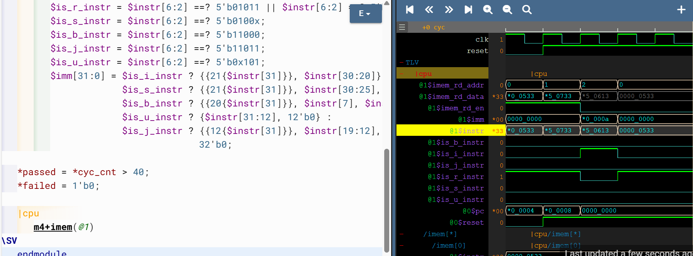

# RV_D4SK2_L4 – Lab for Instruction Immediate Decode Logic

**Day 4 · Basic RISC-V CPU Micro-architecture**  
**Sub-kit D4SK2: Fetch and Decode**

## Overview

Most RISC-V instructions carry an immediate (constant) value inside the instruction bits. Each instruction type stores these bits in different positions, so `$imm[31:0]` is assembled differently for I, S, B, U and J types, using concatenation `{…}` and sign extension `{n{$instr[31]}}`.

## Immediate Formats

| Type | `$imm[31:0]` | Bits |
|---|---|---|
| I | `{21{instr[31]}, instr[30:20]}` | 21 + 11 |
| S | `{21{instr[31]}, instr[30:25], instr[11:7]}` | 21 + 6 + 5 |
| B | `{20{instr[31]}, instr[7], instr[30:25], instr[11:8], 1'b0}` | 20 + 1 + 6 + 4 + 1 |
| U | `{instr[31:12], 12'b0}` | 20 + 12 |
| J | `{12{instr[31]}, instr[19:12], instr[20], instr[30:21], 1'b0}` | 12 + 8 + 1 + 10 + 1 |
| R | no immediate → `32'b0` | |

- `{n{$instr[31]}}` repeats the sign bit: a negative immediate stays negative in 32 bits (sign extension).
- B and J immediates end in `0` because branch and jump targets are multiples of 2 bytes.
- U-type immediates fill the upper 20 bits (used by LUI / AUIPC).

## Code

Complete file: [`src/labs/D4SK2_L4_imm_decode.tlv`](../src/labs/D4SK2_L4_imm_decode.tlv)

```tlv
         $imm[31:0] = $is_i_instr ? {{21{$instr[31]}}, $instr[30:20]} :
                      $is_s_instr ? {{21{$instr[31]}}, $instr[30:25], $instr[11:7]} :
                      $is_b_instr ? {{20{$instr[31]}}, $instr[7], $instr[30:25], $instr[11:8], 1'b0} :
                      $is_u_instr ? {$instr[31:12], 12'b0} :
                      $is_j_instr ? {{12{$instr[31]}}, $instr[19:12], $instr[20], $instr[30:21], 1'b0} :
                                    32'b0;
```

(added in `@1` after the instruction-type decode)

## Screenshot



Reading the waveform:

| addr | instr | Instruction | Type | `$imm` |
|---|---|---|---|---|
| 0 | `0000_0533` | ADD r10, r0, r0 | R | `0000_0000` |
| 1 | `0005_0733` | ADD r14, r10, r0 | R | `0000_0000` |
| 2 | `00a5_0613` | ADDI r12, r10, 10 | I | `0000_000a` (= 10) |

Expected for the rest of the program: ADDI r13, r13, 1 → `0000_0001`; BLT r13, r12, loop → `ffff_fff8` (= −8, a branch back two instructions; the `f`s come from sign extension).

## My Observations

- `$imm` follows the instruction type: R-type ADDs give 0, and the ADDI at address 2 gives `000a`, exactly the constant 10 in the program.
- The I-immediate is simply `instr[31:20]` with sign extension; the other formats scatter the bits so that the register fields stay in the same positions in every format.
- Sign extension matters for branches: the BLT offset is −8, which must become `ffff_fff8` in 32 bits.

---

[⬅ Back to index](../README.md)
