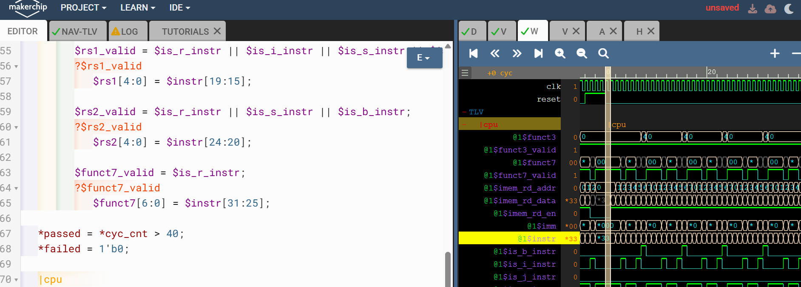

# RV_D4SK2_L5 – Lab to Decode Other Fields of Instructions (RV-ISBUJ)

**Day 4 · Basic RISC-V CPU Micro-architecture**  
**Sub-kit D4SK2: Fetch and Decode**

## Overview

Apart from the immediate, the instruction fields `opcode`, `rd`, `funct3`, `rs1`, `rs2` and `funct7` sit at the **same bit positions in every format**, which keeps RISC-V decoding simple. Each field is only meaningful for some instruction types, so a `_valid` signal is created for each field and the field is placed in a `?$..._valid` scope.

## Field Positions

| Field | Bits | Width | Present in |
|---|---|---|---|
| `$opcode` | `instr[6:0]` | 7 | all |
| `$rd` | `instr[11:7]` | 5 | R, I, U, J |
| `$funct3` | `instr[14:12]` | 3 | R, I, S, B |
| `$rs1` | `instr[19:15]` | 5 | R, I, S, B |
| `$rs2` | `instr[24:20]` | 5 | R, S, B |
| `$funct7` | `instr[31:25]` | 7 | R |

In S- and B-type instructions, bits `[11:7]` hold immediate bits, so these types have no `rd`.

## Code

Complete file: [`src/labs/D4SK2_L5_field_decode.tlv`](../src/labs/D4SK2_L5_field_decode.tlv)

```tlv
         $opcode[6:0] = $instr[6:0];
         
         $rd_valid = $is_r_instr || $is_i_instr || $is_u_instr || $is_j_instr;
         ?$rd_valid
            $rd[4:0] = $instr[11:7];
         
         $funct3_valid = $is_r_instr || $is_i_instr || $is_s_instr || $is_b_instr;
         ?$funct3_valid
            $funct3[2:0] = $instr[14:12];
         
         $rs1_valid = $is_r_instr || $is_i_instr || $is_s_instr || $is_b_instr;
         ?$rs1_valid
            $rs1[4:0] = $instr[19:15];
         
         $rs2_valid = $is_r_instr || $is_s_instr || $is_b_instr;
         ?$rs2_valid
            $rs2[4:0] = $instr[24:20];
         
         $funct7_valid = $is_r_instr;
         ?$funct7_valid
            $funct7[6:0] = $instr[31:25];
```

## Screenshot



Reading the waveform:

- `funct3_valid` is 1 for every instruction in the program (R, I and B types all have `funct3`).
- `funct3` is `0` for ADD/ADDI and `4` (`100`) for BLT, the "less than" branch.
- `funct7_valid` follows `is_r_instr`: it is high for the ADDs and low for ADDI and BLT, where `funct7` is shown as don't-care.
- `funct7` is `00` for ADD (SUB would have `20`).

Expected fields for the test program (hex):

| Instruction | rd | rs1 | rs2 | funct3 | funct7 | opcode |
|---|---|---|---|---|---|---|
| ADDI r12, r10, 10 | 0c | 0a | – | 0 | – | 13 |
| ADD r14, r13, r14 | 0e | 0d | 0e | 0 | 00 | 33 |
| BLT r13, r12, loop | – | 0d | 0c | 4 | – | 63 |

(– = not valid for this instruction type, shown grey in Makerchip)

## My Observations

- The fixed positions of `rs1`, `rs2` and `rd` across all formats mean the register file can start reading before the instruction type is fully decoded.
- The `_valid` signals plus `?$` scopes make the waveform self-explanatory: fields that do not exist for an instruction are greyed out instead of showing misleading values.
- `funct3` and `funct7` together with `opcode` identify the exact instruction, which is the next lab (individual instruction decode).

---

[⬅ Back to index](../README.md)
