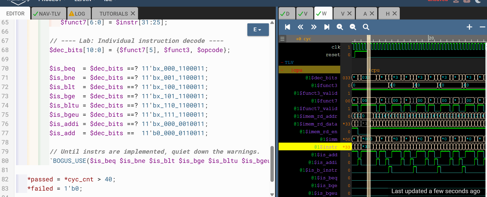

# RV_D4SK2_L7 – Lab to Decode Individual Instructions

**Day 4 · Basic RISC-V CPU Micro-architecture**  
**Sub-kit D4SK2: Fetch and Decode**

## Overview

The instruction type (I, R, S, B …) is not enough to execute an instruction; the CPU must know the exact instruction. Three fields together identify it, combined into an 11-bit `$dec_bits`:

```
$dec_bits[10:0] = {$funct7[5], $funct3, $opcode};   // 1 + 3 + 7 bits
```

- `opcode` selects the group (e.g. `1100011` = conditional branches),
- `funct3` selects the instruction within the group (e.g. `000` BEQ, `100` BLT),
- `funct7[5]` separates ADD (`0`) from SUB (`1`), which share opcode and funct3.

## Decode Table (RV32I subset used so far)

| Instruction | funct7[5] | funct3 | opcode | Pattern |
|---|---|---|---|---|
| BEQ | x | 000 | 1100011 | `11'bx_000_1100011` |
| BNE | x | 001 | 1100011 | `11'bx_001_1100011` |
| BLT | x | 100 | 1100011 | `11'bx_100_1100011` |
| BGE | x | 101 | 1100011 | `11'bx_101_1100011` |
| BLTU | x | 110 | 1100011 | `11'bx_110_1100011` |
| BGEU | x | 111 | 1100011 | `11'bx_111_1100011` |
| ADDI | x | 000 | 0010011 | `11'bx_000_0010011` |
| ADD | 0 | 000 | 0110011 | `11'b0_000_0110011` |

`x` = don't care (used with the wildcard compare `==?`); ADD needs the exact compare because `funct7[5]` must be 0.

## Code

Complete file: [`src/labs/D4SK2_L7_instr_decode.tlv`](../src/labs/D4SK2_L7_instr_decode.tlv)

```tlv
         $dec_bits[10:0] = {$funct7[5], $funct3, $opcode};
         
         $is_beq  = $dec_bits ==? 11'bx_000_1100011;
         $is_bne  = $dec_bits ==? 11'bx_001_1100011;
         $is_blt  = $dec_bits ==? 11'bx_100_1100011;
         $is_bge  = $dec_bits ==? 11'bx_101_1100011;
         $is_bltu = $dec_bits ==? 11'bx_110_1100011;
         $is_bgeu = $dec_bits ==? 11'bx_111_1100011;
         $is_addi = $dec_bits ==? 11'bx_000_0010011;
         $is_add  = $dec_bits ==  11'b0_000_0110011;
         
         // Until instrs are implemented, quiet down the warnings.
         `BOGUS_USE($is_beq $is_bne $is_blt $is_bge $is_bltu $is_bgeu $is_addi $is_add)
```

`` `BOGUS_USE(…) `` marks the signals as used so Makerchip does not warn about them before the ALU and branch logic are added (signals separated by spaces, no commas).

## Screenshot



Reading the waveform:

- `$dec_bits` = `033` for ADD (`0_000_0110011`), and the low digits `…13` / `…63` for ADDI / BLT.
- `$is_add` is high for the ADD instructions (addresses 0, 1, 3, 4, 7 of each pass through the program).
- `$is_addi` pulses for the two ADDI instructions (addresses 2 and 5).
- `$is_b_instr` pulses once per pass for BLT (address 6), where `funct3` = 4; `$is_beq`, `$is_bge`, `$is_bgeu` stay 0 because the program has no such branches.

## My Observations

- Exactly one individual decode signal is high per instruction, and it agrees with the type decode from L3 (ADD → R, ADDI → I, BLT → B).
- Using `funct7[5]` only (not all 7 bits) is enough for RV32I, since ADD/SUB and SRL/SRA differ only in that bit.
- The wildcard compare `==?` keeps the decode compact; one line per instruction.

---

[⬅ Back to index](../README.md)
