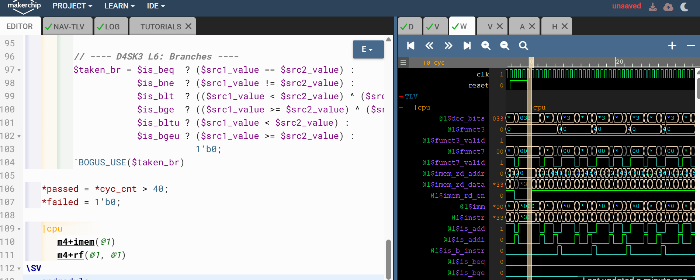

# RV_D4SK3_L6 – Lab for Implementing Branch Instructions

**Day 4 · Basic RISC-V CPU Micro-architecture**  
**Sub-kit D4SK3: RISC-V Control Logic**

## Overview

A conditional branch is taken when a comparison between the two source registers is true. `$taken_br` is computed as a ternary expression over the decoded branch instructions (`$is_beq`, `$is_bne`, …), defaulting to `1'b0` for non-branch instructions. This corresponds to the `< >` comparator on the slide's CPU diagram; the branch target and PC update follow in L7.

## Branch Conditions

| Instruction | Taken when | Expression |
|---|---|---|
| BEQ | x1 == x2 | `$src1_value == $src2_value` |
| BNE | x1 != x2 | `$src1_value != $src2_value` |
| BLT | x1 < x2 (signed) | `($src1_value < $src2_value) ^ ($src1_value[31] != $src2_value[31])` |
| BGE | x1 >= x2 (signed) | `($src1_value >= $src2_value) ^ ($src1_value[31] != $src2_value[31])` |
| BLTU | x1 < x2 (unsigned) | `$src1_value < $src2_value` |
| BGEU | x1 >= x2 (unsigned) | `$src1_value >= $src2_value` |

Verilog `<` and `>=` on these vectors are unsigned. For the signed BLT/BGE, the result is XOR-ed with "sign bits differ": when one operand is negative and the other positive, the unsigned comparison is reversed, and the XOR corrects it (e.g. −1 = `ffff_ffff` is unsigned-greater than 1, but signed-less).

## Code

Complete file (includes register file read, ALU add/addi and register file write from D4SK3 L1–L4): [`src/labs/D4SK3_L6_branches.tlv`](../src/labs/D4SK3_L6_branches.tlv)

```tlv
         $taken_br = $is_beq  ? ($src1_value == $src2_value) :
                     $is_bne  ? ($src1_value != $src2_value) :
                     $is_blt  ? (($src1_value < $src2_value) ^ ($src1_value[31] != $src2_value[31])) :
                     $is_bge  ? (($src1_value >= $src2_value) ^ ($src1_value[31] != $src2_value[31])) :
                     $is_bltu ? ($src1_value < $src2_value) :
                     $is_bgeu ? ($src1_value >= $src2_value) :
                                1'b0;
         `BOGUS_USE($taken_br)
```

## Screenshot



The design compiles cleanly (all tabs green). The waveform shows the decode signals feeding the branch logic: `is_b_instr` pulses once per pass through the program at the BLT instruction, while `is_beq`, `is_bge` and the other branch types stay 0. `$taken_br` (further down the signal list) is 0 for all non-branch instructions and evaluates the BLT comparison at address 6 (first pass: r13 = 1 < r12 = 10 → taken).

## My Observations

- `$taken_br` only reports whether the branch *should* be taken; the PC still increments by 4 until the branch target is connected in L7.
- Signed comparisons need special handling because Verilog vectors compare as unsigned by default; the XOR with the sign-bit difference is a cheap way to get a signed result.
- Defaulting to `1'b0` ensures non-branch instructions never redirect the PC.

---

[⬅ Back to index](../README.md)
