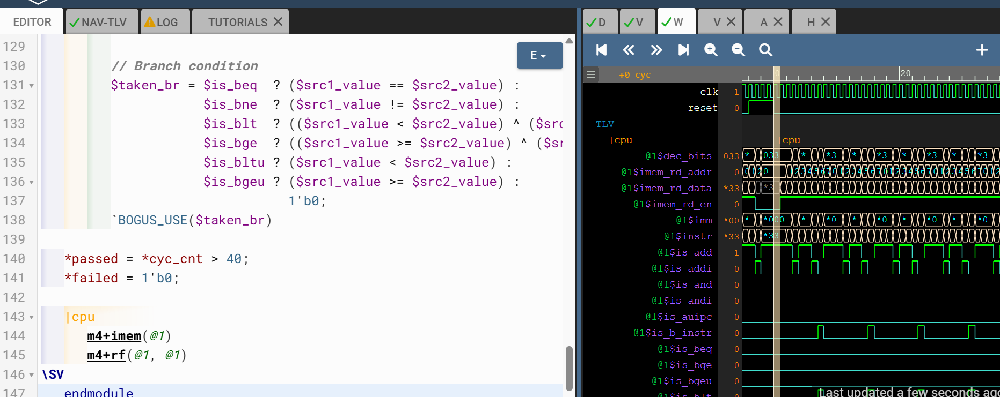

# RV_D5SK2_L3 – Lab to Complete Instruction Decode (except FENCE, ECALL, EBREAK)

**Day 5 · Complete Pipelined RISC-V CPU Micro-architecture**  
**Sub-kit D5SK2: Solutions to Pipeline Hazards**

## Overview

Until now only BEQ…BGEU, ADDI and ADD were decoded. This lab decodes every RV32I instruction except FENCE, ECALL and EBREAK. Each instruction is identified by the 11-bit `$dec_bits = {funct7[5], funct3, opcode}`; all loads are treated the same and recognised by their opcode only (`$is_load`).

## How the Patterns Are Built

| Group | Bits that matter | Example |
|---|---|---|
| LUI, AUIPC, JAL | opcode only | LUI = `x_xxx_0110111` |
| JALR, branches, stores, ADDI…ANDI | funct3 + opcode | XORI = `x_100_0010011` |
| SLLI/SRLI/SRAI and all R-type | funct7[5] + funct3 + opcode | SUB = `1_000_0110011`, SRA = `1_101_0110011` |
| Loads (LB, LH, LW, LBU, LHU) | opcode only | `$is_load = $instr[6:0] == 7'b0000011` |

`funct7[5]` (instruction bit 30) is what separates ADD/SUB, SRL/SRA and SRLI/SRAI.

## Code

Complete file: [`src/labs/D5SK2_L3_complete_decode.tlv`](../src/labs/D5SK2_L3_complete_decode.tlv)

```tlv
         $dec_bits[10:0] = {$instr[30], $instr[14:12], $instr[6:0]};
         
         $is_lui   = $dec_bits ==? 11'bx_xxx_0110111;
         $is_auipc = $dec_bits ==? 11'bx_xxx_0010111;
         $is_jal   = $dec_bits ==? 11'bx_xxx_1101111;
         $is_jalr  = $dec_bits ==? 11'bx_000_1100111;
         
         $is_beq   = $dec_bits ==? 11'bx_000_1100011;
         $is_bne   = $dec_bits ==? 11'bx_001_1100011;
         $is_blt   = $dec_bits ==? 11'bx_100_1100011;
         $is_bge   = $dec_bits ==? 11'bx_101_1100011;
         $is_bltu  = $dec_bits ==? 11'bx_110_1100011;
         $is_bgeu  = $dec_bits ==? 11'bx_111_1100011;
         
         $is_load  = $instr[6:0] == 7'b0000011;
         $is_sb    = $dec_bits ==? 11'bx_000_0100011;
         $is_sh    = $dec_bits ==? 11'bx_001_0100011;
         $is_sw    = $dec_bits ==? 11'bx_010_0100011;
         
         $is_addi  = $dec_bits ==? 11'bx_000_0010011;
         $is_slti  = $dec_bits ==? 11'bx_010_0010011;
         $is_sltiu = $dec_bits ==? 11'bx_011_0010011;
         $is_xori  = $dec_bits ==? 11'bx_100_0010011;
         $is_ori   = $dec_bits ==? 11'bx_110_0010011;
         $is_andi  = $dec_bits ==? 11'bx_111_0010011;
         $is_slli  = $dec_bits ==? 11'b0_001_0010011;
         $is_srli  = $dec_bits ==? 11'b0_101_0010011;
         $is_srai  = $dec_bits ==? 11'b1_101_0010011;
         
         $is_add   = $dec_bits ==? 11'b0_000_0110011;
         $is_sub   = $dec_bits ==? 11'b1_000_0110011;
         $is_sll   = $dec_bits ==? 11'b0_001_0110011;
         $is_slt   = $dec_bits ==? 11'b0_010_0110011;
         $is_sltu  = $dec_bits ==? 11'b0_011_0110011;
         $is_xor   = $dec_bits ==? 11'b0_100_0110011;
         $is_srl   = $dec_bits ==? 11'b0_101_0110011;
         $is_sra   = $dec_bits ==? 11'b1_101_0110011;
         $is_or    = $dec_bits ==? 11'b0_110_0110011;
         $is_and   = $dec_bits ==? 11'b0_111_0110011;
```

Unused signals are listed in short `` `BOGUS_USE(…) `` lines (space-separated) to silence warnings until the ALU uses them.

## Screenshot



All tabs compile (green ✓). In the waveform, `is_add` is high for the ADD instructions, `is_addi` for the two ADDIs, `is_b_instr` pulses at the BLT, and the newly added signals (`is_and`, `is_andi`, `is_auipc`, `is_beq`, `is_bge`, `is_bgeu`, …) stay 0 because the sum-1-to-9 program does not use them.

## My Observations

- Building `$dec_bits` straight from instruction bits (`instr[30]`, `instr[14:12]`, `instr[6:0]`) avoids depending on the `?$valid`-scoped `funct3`/`funct7` signals.
- A first version failed to compile after pasting; rewriting with one definition per signal and short `BOGUS_USE` lines fixed it.
- Only one `is_*` signal is high per instruction, confirming the patterns do not overlap.

---

[⬅ Back to index](../README.md)
